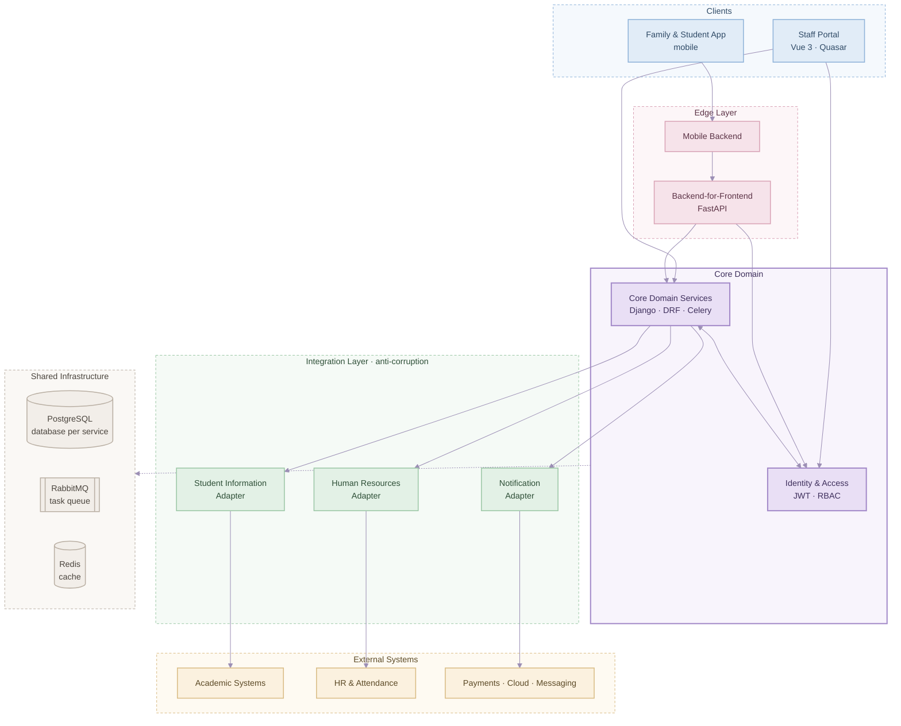

  

  <em>“Simplicity is prerequisite for reliability.”</em> 
  — Edsger W. Dijkstra

⚜ &nbsp;━━━━━━━━━━━━━━━━━━━━━━━━ &nbsp;⚜

## ❦ &nbsp;Prologue

I am a software engineer whose principal practice lies in the **design and stewardship of backend systems**.
My professional work is devoted to a service-oriented platform that supports the daily administration of an
**international school**, serving faculty, families and students alike. My interests reside at the
intersection of *software architecture*, *system integration* and *operational reliability*: the discipline
of making many independent components behave as one coherent and trustworthy whole.

⚜ &nbsp;━━━━━━━━━━━━━━━━━━━━━━━━ &nbsp;⚜

## ❦ &nbsp;Principal Engagement

**Software Engineer · School Management Platform for an International School**

The platform is composed of a family of services, each entrusted with a distinct responsibility across the
academic lifecycle: admissions and enrolment, student records, tuition and finance, communication with
families, and integration with external academic and human-resources systems.

### Areas of Responsibility

| | Domain | Description |
|:-:|---|---|
| Ⅰ | **Service & Interface Design** | Formulating domain models and RESTful contracts for services that each govern their own data. |
| Ⅱ | **Identity & Authorisation** | Stateless, token-based authentication across service boundaries; role- and scope-based access control. |
| Ⅲ | **Systems Integration** | Encapsulating third-party systems behind adapters so that external models never permeate the core domain. |
| Ⅳ | **Asynchronous Processing** | Task queues, retry semantics, outbox-style delivery, idempotent synchronisation and reconciliation. |
| Ⅴ | **Schema Evolution** | Preserving a consistent and auditable migration lineage across every environment. |
| Ⅵ | **Delivery & Automation** | Continuous integration and containerised deployment; converting manual procedure into versioned configuration. |
| Ⅶ | **Architectural Review** | Evaluating the system against established microservice principles and charting improvements in resilience, observability and event-driven communication. |

⚜ &nbsp;━━━━━━━━━━━━━━━━━━━━━━━━ &nbsp;⚜

## ❦ &nbsp;Technical Repertoire

  
  
  
  
  
   
  
  
  
   
  
  
  
  

| Discipline | Instruments |
|---|---|
| **Service Engineering** | Python · Django · Django REST Framework · Celery |
| **Lightweight Services** | FastAPI · asynchronous HTTP clients · SQLAlchemy · Pydantic |
| **Security & Identity** | JSON Web Tokens with asymmetric signatures · role-based access control |
| **Data Persistence** | PostgreSQL · Redis · multi-database routing |
| **Asynchronous Messaging** | RabbitMQ · background workers · scheduled tasks |
| **Presentation Layer** | Vue 3 · Quasar · Pinia |
| **Delivery** | Docker · Docker Compose · Jenkins · disciplined Git workflow |

⚜ &nbsp;━━━━━━━━━━━━━━━━━━━━━━━━ &nbsp;⚜

## ❦ &nbsp;Methodological Principles

> *Database per Service* &nbsp;·&nbsp; *Stateless Authentication* &nbsp;·&nbsp; *Backend for Frontend*
> &nbsp;·&nbsp; *Anti-Corruption Layer* &nbsp;·&nbsp; *Transactional Outbox* &nbsp;·&nbsp; *Idempotency & Reconciliation*
> &nbsp;·&nbsp; *Cache-Aside* &nbsp;·&nbsp; *Adapter, Proxy, Strategy & Repository* &nbsp;·&nbsp; *Dependency Injection*
> &nbsp;·&nbsp; *The Twelve-Factor Application*

⚜ &nbsp;━━━━━━━━━━━━━━━━━━━━━━━━ &nbsp;⚜

  

